# EXPRESS System - Data Flow Architecture Diagram

## Overview
The EXPRESS system implements a sophisticated data flow architecture that ensures data integrity, real-time processing, and seamless integration across all components. The architecture is designed around three core flows that work together to provide a complete survey research solution.

```
┌─────────────────────────────────────────────────────────────────────────────────────────────┐
│                                    EXPRESS SYSTEM                                          │
│                              DATA FLOW ARCHITECTURE                                        │
└─────────────────────────────────────────────────────────────────────────────────────────────┘

┌─────────────────────────────────────────────────────────────────────────────────────────────┐
│                                         USER INTERFACE                                     │
│  ┌─────────────────┐  ┌─────────────────┐  ┌─────────────────┐  ┌─────────────────┐      │
│  │   Survey        │  │   Question      │  │   Theme         │  │   Deployment    │      │
│  │   Creation      │  │   Configuration │  │   Application   │  │   Management    │      │
│  └─────────────────┘  └─────────────────┘  └─────────────────┘  └─────────────────┘      │
└─────────────────────────────────────────────────────────────────────────────────────────────┘
                                        │
                                        ▼
┌─────────────────────────────────────────────────────────────────────────────────────────────┐
│                                    3.3.1 INPUT FLOW                                       │
│                                                                                             │
│  ┌─────────────────┐    ┌─────────────────┐    ┌─────────────────┐    ┌─────────────────┐  │
│  │   1. Survey     │───▶│   2. Question   │───▶│   3. Theme      │───▶│   4. Deployment │  │
│  │   Creation      │    │   Configuration │    │   Application   │    │   & Activation  │  │
│  └─────────────────┘    └─────────────────┘    └─────────────────┘    └─────────────────┘  │
│         │                        │                        │                        │        │
│         ▼                        ▼                        ▼                        ▼        │
│  ┌─────────────────┐    ┌─────────────────┐    ┌─────────────────┐    ┌─────────────────┐  │
│  │ • Web Interface │    │ • 14 Question   │    │ • Visual        │    │ • Survey URL    │  │
│  │ • API Creation  │    │   Types         │    │   Styling       │    │   Generation    │  │
│  │ • Template      │    │ • Logic Rules   │    │ • Branding      │    │ • Access        │  │
│  │   System        │    │ • Flow Control  │    │ • Customization │    │   Control       │  │
│  │ • Bulk Import   │    │ • Validation    │    │ • Responsive    │    │ • Privacy       │  │
│  └─────────────────┘    └─────────────────┘    └─────────────────┘    └─────────────────┘  │
└─────────────────────────────────────────────────────────────────────────────────────────────┘
                                        │
                                        ▼
┌─────────────────────────────────────────────────────────────────────────────────────────────┐
│                                   SURVEY DEPLOYMENT                                       │
│  ┌─────────────────┐    ┌─────────────────┐    ┌─────────────────┐    ┌─────────────────┐  │
│  │   Survey        │    │   Unique URL    │    │   Access        │    │   Session       │  │
│  │   Validation    │───▶│   Generation    │───▶│   Permissions   │───▶│   Initialization│  │
│  └─────────────────┘    └─────────────────┘    └─────────────────┘    └─────────────────┘  │
└─────────────────────────────────────────────────────────────────────────────────────────────┘
                                        │
                                        ▼
┌─────────────────────────────────────────────────────────────────────────────────────────────┐
│                                3.3.2 DATA COLLECTION FLOW                                 │
│                                                                                             │
│  ┌─────────────────┐    ┌─────────────────┐    ┌─────────────────┐    ┌─────────────────┐  │
│  │   1. Participant│    │   2. Session    │    │   3. Question   │    │   4. Response   │  │
│  │   Access        │───▶│   Initialization│───▶│   Delivery      │───▶│   Capture       │  │
│  └─────────────────┘    └─────────────────┘    └─────────────────┘    └─────────────────┘  │
│         │                        │                        │                        │        │
│         ▼                        ▼                        ▼                        ▼        │
│  ┌─────────────────┐    ┌─────────────────┐    ┌─────────────────┐    ┌─────────────────┐  │
│  │ • Unique Survey │    │ • Session ID    │    │ • Dynamic       │    │ • Real-time     │  │
│  │   URL Access    │    │   Generation    │    │   Question      │    │   Validation    │  │
│  │ • Device        │    │ • Participant   │    │   Rendering     │    │ • Database      │  │
│  │   Detection     │    │   Tracking      │    │ • Logic Flow    │    │   Storage       │  │
│  │ • Browser Info  │    │ • IP Tracking   │    │ • Progress      │    │ • Metadata      │  │
│  └─────────────────┘    └─────────────────┘    │   Tracking      │    │   Capture       │  │
│                                                 └─────────────────┘    └─────────────────┘  │
│                                                                                             │
│  ┌─────────────────┐    ┌─────────────────┐    ┌─────────────────┐    ┌─────────────────┐  │
│  │   5. Progress   │    │   6. Session    │    │   7. Data       │    │   8. Quality    │  │
│  │   Tracking      │───▶│   Management    │───▶│   Persistence   │───▶│   Control       │  │
│  └─────────────────┘    └─────────────────┘    └─────────────────┘    └─────────────────┘  │
│         │                        │                        │                        │        │
│         ▼                        ▼                        ▼                        ▼        │
│  ┌─────────────────┐    ┌─────────────────┐    ┌─────────────────┐    ┌─────────────────┐  │
│  │ • Completion    │    │ • Session       │    │ • Real-time     │    │ • Response      │  │
│  │   Percentage    │    │   Persistence   │    │   Backup        │    │   Validation    │  │
│  │ • Time          │    │ • Timeout       │    │ • Data          │    │ • Outlier       │  │
│  │   Estimates     │    │ • Management    │    │   Integrity     │    │   Detection     │  │
│  │ • Quality       │    │ • Cleanup       │    │ • Version       │    │ • Duplicate     │  │
│  │   Metrics       │    │ • Procedures    │    │   Control       │    │   Prevention    │  │
│  └─────────────────┘    └─────────────────┘    └─────────────────┘    └─────────────────┘  │
└─────────────────────────────────────────────────────────────────────────────────────────────┘
                                        │
                                        ▼
┌─────────────────────────────────────────────────────────────────────────────────────────────┐
│                                     DATA STORAGE                                          │
│  ┌─────────────────┐    ┌─────────────────┐    ┌─────────────────┐    ┌─────────────────┐  │
│  │   Response      │    │   Session       │    │   Metadata      │    │   Analytics     │  │
│  │   Database      │    │   Database      │    │   Storage       │    │   Cache         │  │
│  └─────────────────┘    └─────────────────┘    └─────────────────┘    └─────────────────┘  │
└─────────────────────────────────────────────────────────────────────────────────────────────┘
                                        │
                                        ▼
┌─────────────────────────────────────────────────────────────────────────────────────────────┐
│                                3.3.3 ANALYTICS FLOW                                       │
│                                                                                             │
│  ┌─────────────────┐    ┌─────────────────┐    ┌─────────────────┐    ┌─────────────────┐  │
│  │   1. Data       │    │   2. Statistical│    │   3. Quality    │    │   4. Report     │  │
│  │   Aggregation   │───▶│   Analysis      │───▶│   Monitoring    │───▶│   Generation    │  │
│  └─────────────────┘    └─────────────────┘    └─────────────────┘    └─────────────────┘  │
│         │                        │                        │                        │        │
│         ▼                        ▼                        ▼                        ▼        │
│  ┌─────────────────┐    ┌─────────────────┐    ┌─────────────────┐    ┌─────────────────┐  │
│  │ • Raw Response  │    │ • Percentages   │    │ • Response      │    │ • Multiple      │  │
│  │   Collection    │    │   & Counts      │    │   Quality       │    │   Formats       │  │
│  │ • Data          │    │ • Cross-        │    │ • Metrics       │    │   (Excel, PDF,  │  │
│  │   Validation    │    │   tabulation    │    │ • Outlier       │    │   JSON)         │  │
│  │ • Real-time     │    │ • Trend         │    │ • Detection     │    │ • Charts &      │  │
│  │   Processing    │    │   Analysis      │    │ • Completion    │    │   Visualizations│  │
│  └─────────────────┘    └─────────────────┘    │   Rates        │    │ • Custom        │  │
│                                                 └─────────────────┘    │   Dashboards    │  │
│                                                                        └─────────────────┘  │
│  ┌─────────────────┐    ┌─────────────────┐    ┌─────────────────┐    ┌─────────────────┐  │
│  │   5. Data       │    │   6. Real-time  │    │   7. Export     │    │   8. Integration│  │
│  │   Export        │───▶│   Updates       │───▶│   & API         │───▶│   & Sync        │  │
│  └─────────────────┘    └─────────────────┘    └─────────────────┘    └─────────────────┘  │
│         │                        │                        │                        │        │
│         ▼                        ▼                        ▼                        ▼        │
│  ┌─────────────────┐    ┌─────────────────┐    ┌─────────────────┐    ┌─────────────────┐  │
│  │ • External      │    │ • Live          │    │ • RESTful APIs  │    │ • Fluent        │  │
│  │   Systems       │    │   Dashboard     │    │ • Webhook       │    │   Platform      │  │
│  │ • CRM Systems   │    │   Updates       │    │   Support       │    │   Sync          │  │
│  • Business       │    │ • Trend         │    │ • Rate Limiting │    │ • External      │  │
│  │   Intelligence  │    │   Detection     │    │ • Authentication│    │   Analytics     │  │
│  │   Tools         │    │ • Anomaly       │    │ • Access        │    │   Platforms     │  │
│  └─────────────────┘    │   Identification│    │   Control       │    └─────────────────┘  │
│                         └─────────────────┘    └─────────────────┘                        │
└─────────────────────────────────────────────────────────────────────────────────────────────┘
                                        │
                                        ▼
┌─────────────────────────────────────────────────────────────────────────────────────────────┐
│                                   EXTERNAL INTEGRATIONS                                    │
│  ┌─────────────────┐  ┌─────────────────┐  ┌─────────────────┐  ┌─────────────────┐      │
│  │   Fluent        │  │   CRM Systems   │  │   Business      │  │   Custom        │      │
│  │   Platform      │  │   (Salesforce)  │  │   Intelligence  │  │   Analytics     │      │
│  │   Integration   │  │   Integration   │  │   Tools         │  │   Platforms     │      │
│  └─────────────────┘  └─────────────────┘  └─────────────────┘  └─────────────────┘      │
└─────────────────────────────────────────────────────────────────────────────────────────────┘

## Mermaid Diagram

```mermaid
flowchart TD
    %% User Interface Layer
    UI[User Interface<br/>Survey Creation & Management]
    
    %% Input Flow (3.3.1)
    subgraph InputFlow ["3.3.1 Input Flow"]
        SC[Survey Creation<br/>• Web Interface<br/>• API Creation<br/>• Template System<br/>• Bulk Import]
        QC[Question Configuration<br/>• 14 Question Types<br/>• Logic Rules<br/>• Flow Control<br/>• Validation]
        TA[Theme Application<br/>• Visual Styling<br/>• Branding<br/>• Customization<br/>• Responsive Design]
        DA[Deployment & Activation<br/>• Survey URL Generation<br/>• Access Control<br/>• Privacy Settings]
    end
    
    %% Survey Deployment
    subgraph Deployment ["Survey Deployment"]
        SV[Survey Validation]
        UG[Unique URL Generation]
        AP[Access Permissions]
        SI[Session Initialization]
    end
    
    %% Data Collection Flow (3.3.2)
    subgraph DataCollection ["3.3.2 Data Collection Flow"]
        PA[Participant Access<br/>• Unique Survey URL<br/>• Device Detection<br/>• Browser Info]
        SI2[Session Initialization<br/>• Session ID Generation<br/>• Participant Tracking<br/>• IP Tracking]
        QD[Question Delivery<br/>• Dynamic Question Rendering<br/>• Logic Flow<br/>• Progress Tracking]
        RC[Response Capture<br/>• Real-time Validation<br/>• Database Storage<br/>• Metadata Capture]
        PT[Progress Tracking<br/>• Completion Percentage<br/>• Time Estimates<br/>• Quality Metrics]
        SM[Session Management<br/>• Session Persistence<br/>• Timeout Management<br/>• Cleanup Procedures]
        DP[Data Persistence<br/>• Real-time Backup<br/>• Data Integrity<br/>• Version Control]
        QC2[Quality Control<br/>• Response Validation<br/>• Outlier Detection<br/>• Duplicate Prevention]
    end
    
    %% Data Storage
    subgraph Storage ["Data Storage"]
        RDB[Response Database]
        SDB[Session Database]
        MDS[Metadata Storage]
        AC[Analytics Cache]
    end
    
    %% Analytics Flow (3.3.3)
    subgraph Analytics ["3.3.3 Analytics Flow"]
        AG[Data Aggregation<br/>• Raw Response Collection<br/>• Data Validation<br/>• Real-time Processing]
        SA[Statistical Analysis<br/>• Percentages & Counts<br/>• Cross-tabulation<br/>• Trend Analysis]
        QM[Quality Monitoring<br/>• Response Quality Metrics<br/>• Outlier Detection<br/>• Completion Rates]
        RG[Report Generation<br/>• Multiple Formats<br/>• Charts & Visualizations<br/>• Custom Dashboards]
        DE[Data Export<br/>• External Systems<br/>• CRM Systems<br/>• Business Intelligence Tools]
        RU[Real-time Updates<br/>• Live Dashboard<br/>• Trend Detection<br/>• Anomaly Identification]
        API[Export & API<br/>• RESTful APIs<br/>• Webhook Support<br/>• Rate Limiting<br/>• Authentication]
        IS[Integration & Sync<br/>• Fluent Platform Sync<br/>• External Analytics<br/>• Data Synchronization]
    end
    
    %% External Integrations
    subgraph External ["External Integrations"]
        FP[Fluent Platform<br/>Integration]
        CRM[CRM Systems<br/>Salesforce]
        BI[Business Intelligence<br/>Tools]
        CAP[Custom Analytics<br/>Platforms]
    end
    
    %% Connections - Input Flow
    UI --> SC
    SC --> QC
    QC --> TA
    TA --> DA
    
    %% Connections - Deployment
    DA --> SV
    SV --> UG
    UG --> AP
    AP --> SI
    
    %% Connections - Data Collection Flow
    SI --> PA
    PA --> SI2
    SI2 --> QD
    QD --> RC
    RC --> PT
    PT --> SM
    SM --> DP
    DP --> QC2
    
    %% Connections - Storage
    RC --> RDB
    SI2 --> SDB
    RC --> MDS
    QC2 --> AC
    
    %% Connections - Analytics Flow
    RDB --> AG
    SDB --> AG
    MDS --> AG
    AC --> AG
    
    AG --> SA
    SA --> QM
    QM --> RG
    RG --> DE
    DE --> RU
    RU --> API
    API --> IS
    
    %% Connections - External
    IS --> FP
    IS --> CRM
    IS --> BI
    IS --> CAP
    
    %% Styling
    classDef inputFlow fill:#e1f5fe,stroke:#01579b,stroke-width:2px
    classDef dataCollection fill:#f3e5f5,stroke:#4a148c,stroke-width:2px
    classDef analytics fill:#e8f5e8,stroke:#1b5e20,stroke-width:2px
    classDef deployment fill:#fff3e0,stroke:#e65100,stroke-width:2px
    classDef storage fill:#fce4ec,stroke:#880e4f,stroke-width:2px
    classDef external fill:#f1f8e9,stroke:#33691e,stroke-width:2px
    
    class SC,QC,TA,DA inputFlow
    class PA,SI2,QD,RC,PT,SM,DP,QC2 dataCollection
    class AG,SA,QM,RG,DE,RU,API,IS analytics
    class SV,UG,AP,SI deployment
    class RDB,SDB,MDS,AC storage
    class FP,CRM,BI,CAP external
```



## Key Data Flow Characteristics

### Real-time Processing
- **Immediate Response Capture**: Responses are processed and stored in real-time
- **Live Analytics Updates**: Dashboard and analytics update continuously
- **Instant Integration**: Webhooks and APIs provide immediate data synchronization

### Data Integrity
- **Validation at Every Step**: Input validation, response validation, and quality control
- **Duplicate Prevention**: Advanced mechanisms to prevent duplicate responses
- **Session Management**: Robust session handling with data persistence

### Scalability
- **Horizontal Scaling**: Support for load balancing and distributed processing
- **Caching Strategy**: Intelligent caching for frequently accessed data
- **Database Optimization**: Optimized queries and indexing for performance

### Security
- **Authentication**: Token-based authentication for secure access
- **Rate Limiting**: Protection against API abuse and overload
- **Access Control**: Granular permissions and role-based access control

## Data Flow Summary

1. **Input Flow (3.3.1)**: Survey creation → Configuration → Styling → Deployment
2. **Data Collection Flow (3.3.2)**: Access → Session → Questions → Responses → Progress → Quality
3. **Analytics Flow (3.3.3)**: Aggregation → Analysis → Monitoring → Reports → Export → Integration

The architecture ensures seamless data flow from survey creation through data collection to comprehensive analytics, with real-time processing, robust validation, and extensive integration capabilities.
